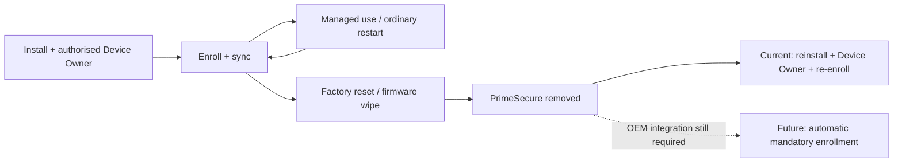

# PrimeSecure — three-device pilot readiness

**Prepared 17 October 2026 · Pilot: 18 October · School: Rusununguko ZIMFEP**

**Decision: controlled pilot, not yet a 300-device security sign-off.** Android controls need Device Owner. A saved dashboard switch is a request; confirm the device's reported result and test the behaviour. New settings hardening requires 0.8.7+. Current candidate: **0.8.9 (26), published paused**, adding Prime Media with school collections, in-app YouTube playback, controlled search and on-demand offline media downloads.

**Pilot configuration:** school settings lockdown requested ON; debugging restriction and Wi-Fi configuration lock OFF until provisioning/recovery checks pass. Older agents ignore the new controls. Automated checks: **72 native tests, 82 database/isolation tests**, four URL-validation tests, release/lint checks and guide browser checks; physical pilot gates below remain open.

## Problems, changes and remaining checks

| Earlier problem | What we now have | Evidence / remaining check |
|---|---|---|
| Manual installation and enrollment | Windows PC setup wizard; enrollment keys; initial apps/content preparation | Wizard/process checks exist. Test provisioning on each PrimeOS model. An APK cannot grant itself Device Owner. |
| Restart caused flashing login | Protected login/system roles, startup grace, queued policy application, direct-boot restore journal, emergency safe mode | You reported repeated successful restarts after fixes. Repeat with new hardening; no guarantee against every firmware failure. |
| Blocked apps remained visible | Explicit package rules, hiding/suspension and per-package results | Some firmware apps remain protected/refuse hiding. Do not disable Settings, keyboard, login or launcher to force a result. |
| Uncontrolled Settings changes | 0.8.7: account/app-control/certificate-store restrictions; safe boot, VPN, private DNS, date/location configuration, airplane mode, tethering, network reset; extra-user/reset/install restrictions | Separate debugging and Wi-Fi configuration controls. Per-restriction diagnostics report requested/applied/error. PrimeOS enforcement needs testing. |
| Forgotten passwords led to wipes | PrimeSecure password changes, escrow-token recovery and before-first-unlock recovery channel | Activate and confirm recovery **before** a student forgets the password. Test a temporary reset; credentials are not stored as a plaintext password list. |
| Internet failures blocked useful work | Cached notes/wallpapers/catalog, local wallpaper application, durable offline requests/replies/profile changes and Background tasks | Saved content works offline; an uncached book/app still needs internet. Interrupted downloads need testing. |
| Slow or unclear updates/uploads | School sync revisions, diagnostics, APK progress/selection/holds, signed interface updates and background multi-file uploads | Delivery needs connectivity. App changes require a same-signer, higher-code APK; interface-only changes can arrive separately. |
| Fragmented student tools | Student dashboard, folder notes/search, approved app store, Media/viewers, support/bug reports, guide and repair prices | Approved apps and preferred viewers still need individual loophole review. |
| Missing school content | **435 resources / 832,745,321 bytes**, below 1 GB: robotics, syllabuses, papers, textbooks, English novels, Shona readers and illustrated guides | Published catalog and upload checksums verified. Not proof all files are cached on every device. Supplements require teacher review; Shona readers are not modern prescribed novels. |
| USB/Bluetooth/guest sharing | Android USB/SD mounting, USB transfer, Bluetooth, add-user and user-switch restrictions | Test actual hardware and the OEM login. A restriction flag does not prove PrimeOS blocked a transfer. |
| Lost device / poor visibility | Visible lost lock/alarm, location history/uncertainty, Wi-Fi/device details, usage summaries and cases | Reachability/permissions matter. Location has shown inaccurate fixes; reported GPS accuracy is not independent verification. Camera/support capture requires explicit device participation. |

## Settings and recovery boundaries

| Control | What it does / what it cannot promise |
|---|---|
| **Lock security and account settings** | Blocks standard account changes, app-control settings and the supported restrictions above. Existing accounts are retained. Set up managed school accounts first. Keeps the Settings system package enabled for login safety. |
| **Disable developer and ADB debugging** | Blocks standard developer/USB/wireless debugging. Enable **after** PC provisioning, network and recovery tests. It intentionally stops the technician's ADB connection. It cannot secure an already-rooted OS or an unlocked bootloader. |
| **Lock Wi-Fi/mobile configuration** | Optional; configure school Wi-Fi first. Can prevent adding a replacement hotspot. Leave off for the first connectivity pilot. Does not create a connection where none exists. |
| **Passwords in PrimeSecure** | Supported change/recovery route. Android 11's certificate/credential-store restriction is **not** a guaranteed block on every OEM screen-lock password screen. Complete exclusivity needs firmware/kiosk integration. |
| **Emergency safe mode** | Releases the new journalled restrictions and restores journalled app visibility when received. It is not an offline remote-control channel. Preserve a working network and a tested technician recovery path. |

## Factory reset: still NOT solved

- A normal factory reset removes this user-installed APK, Device Owner state, tokens and local data. **Connecting to the internet does not reinstall PrimeSecure automatically.**
- Standard restrictions can block reset through Android Settings and request safe-boot prevention. They cannot guarantee blocking hardware recovery, reflashing or bootloader-level changes.
- Primebook's OTP setup is its manufacturer's system; it is not proof that PrimeSecure survived the reset. OTP-based recovery/reinitialisation still needs school/OEM assistance.
- Manufacturer assignment/bootstrap is required for reset-persistent installation and mandatory re-enrollment. [The Primebook/Floydwiz request is prepared](primebook-reset-integration-request.md); it has not been sent or implemented. No custom firmware/reset bypass has been shipped.
- Guide notice: unauthorised flashing/reset, or returning with OTP required after a reset, is a serious school offence with the school's **USD $10 system reinitialisation fee**. This notice is a conduct policy, not a technical reset barrier.

## Main loopholes and operational limits

- **Approved does not mean contained:** native apps, document links, embedded browsers, file pickers and editors can expose other content. Review each app; avoid terminals, unrestricted HTML/code runners and additional installers. Our web allowlist is not a universal firewall for all native apps.
- **Public searches are not school-curated:** MP3Juices/Unsplash may show unsuitable results. Consider keeping these entry points off during the first pilot. Media-only file validation prevents APK/HTML downloads through that feature; it does not classify a song/image/video as appropriate.
- **OEM/physical access:** custom login, mounted media, an existing guest account, bootloader or recovery can bypass normal Android assumptions. Restrictions do not remove existing users or secure modified firmware.
- **Offline/reachability:** remote lock, rollback, alarms and password recovery cannot arrive without a usable channel. Before-first-unlock networking remains firmware-dependent. We cannot disable physical power buttons or guarantee accurate tracking.
- **Rollback is bounded:** pause/pin releases, reject a student-interface update or use emergency safe mode. Android normally rejects lower native version codes; older native code may need a newly signed higher-code recovery build. Nothing guarantees remote recovery of an unreachable device.
- **Privacy/licensing:** staff can identify anonymous replies and read support messages; this is not end-to-end encryption. Usage is observed/permission-dependent, not a recording of everything a student sees. File metadata/thumbnails are not a full personal-file backup. Microsoft A1/Google app deployment and 11.6-inch editing entitlement still need the authorised OEM/publisher route.

## Pilot gates — tick on ALL three devices before expanding

- [ ] Confirm Device Owner, correct student/Prime ID, school Wi-Fi, agent version and current sync revision.
- [ ] Activate recovery; test password change and an admin temporary-password reset without losing a sample file.
- [ ] Enable settings lockdown; try account addition, app force-stop/data clearing, VPN/DNS and Settings reset. Inspect `settings_lockdown_applied` / `settings_restriction_failed` diagnostics.
- [ ] Reboot at least three times; log in; test loss/reconnection of Wi-Fi and before-first-unlock reachability.
- [ ] Test USB drive, SD card, USB transfer, inbound/outbound Bluetooth and guest/new-user entry points.
- [ ] Test required-app install, optional install/removal, PDF/media viewing, wallpaper, offline notes and queued support/replies.
- [ ] Test a real download through an approved popup/redirect; verify ads/outside hosts stay blocked and URL withdrawal takes effect.
- [ ] Test a one-device update, hold and emergency safe-mode release. Enable debugging restriction last; verify an admin can release it while online.
- [ ] Record device/model, build, result and unresolved failures. **Any login loop, broken recovery or unenforced critical restriction blocks fleet rollout.**

Sources: [Android user-restriction reference](https://developer.android.com/reference/android/os/UserManager), [Android device-policy reference](https://developer.android.com/reference/android/app/admin/DevicePolicyManager), repository implementation and the user's physical-device reports. Build/database/browser checks are recorded separately from the pilot gates above.

Prime Media setup and limits: [prime-media.md](prime-media.md). Test a real YouTube search, embedded playback, queued school-file download, offline playback and withdrawal on one Primebook before rollout.
